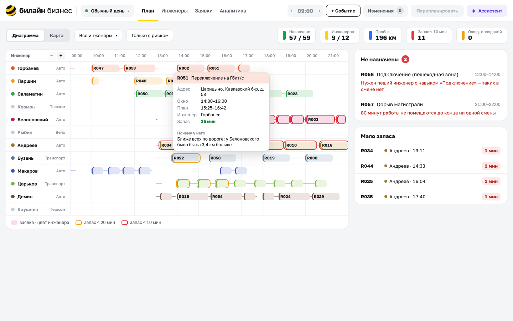

# Команда «Безымянные»

> **Развёрнутый демо-стенд дашбоарда диспетчера доступен по ссылке**: https://lct.k1rles.ru

Прототип решения по кейсу «Интеллектуальный сервис планирования рабочих маршрутов для инженеров с учетом временных окон
и сложности проводимых работ» от Билайн Бизнес на хакатоне [«Лидеры цифровой трансформации 2026»](https://i.moscow/lct) от Правительства Москвы.



## Деплой

Нужен только Docker с Compose v2. Подробности, переменные окружения и что делать, если что-то не
поднялось, описаны в [docs/deployment.md](docs/deployment.md).

```bash
cp .env.example .env          # ключи для ассистента (можно оставить пустыми)
docker compose up -d          # http://localhost:8001
```

## Карта документации

| Документ | О чём |
|---|---|
| [docs/task.md](docs/task.md) | Задача диспетчера, что мы решаем и что сознательно оставили за рамками |
| [docs/architecture.md](docs/architecture.md) | Процессы, модули, поток данных, жизненный цикл плана, API |
| [docs/model.md](docs/model.md) | Математическая модель, движки, перепланирование, запас времени, объяснения |
| [docs/data.md](docs/data.md) | Тестовые наборы: поля, единицы, справочники, встроенные конфликты |
| [docs/preview.md](docs/preview.md) | Интерфейс по шагам демо-сценария, со скриншотами |
| [docs/deployment.md](docs/deployment.md) | Запуск в Docker Compose, переменные, разработка, тесты |
| [docs/limitations.md](docs/limitations.md) | Известные ограничения и что делать дальше |

## Полученный результат

В качестве демонстрации рассматривается следующий сценарий дня: 12 инженеров, 59 заявок в девяти районах ЮАО.

| | Назначено | Инженеров | Пробег | Время расчёта |
|---|---|---|---|---|
| Baseline | 33 из 59 | 12 | 239 км | мгновенно |
| Жадная вставка + локальный поиск | 57 из 59 | 8 | 209 км | 0,2 с |
| OR-Tools, тёплый старт | 57 из 59 | 7 | 204 км | 10 с |

Две заявки не назначены намеренно в качестве заложенных в данные конфликтов: для R056 нет пешего инженера с
навыком подключения, R057 (авария на 80 минут, клиент ждёт с 21 до 22) не помещается ни в одну смену.

Перепланирование после трёх событий из сценария (срочная авария в 13:30, отмена заявки, инженер уходит
в 14:00): быстрый движок - 0,06 с, OR-Tools - 10 с. Срочная заявка встаёт в план, ни одна из ранее
назначенных не теряется, заявки ушедшего инженера разобраны другими.

## Соответствие условию кейса

| Требование | Где сделано |
|---|---|
| Загрузка CSV/JSON или встроенный набор | Три встроенных сценария и загрузка своего файла, [preview](docs/preview.md#1-открыть-набор-данных) |
| Распределение с учётом навыков, транспорта, окон и смен | [model](docs/model.md#ограничения) |
| Маршруты на карте | Leaflet, линии по улицам для авто, [preview](docs/preview.md#3-распределение-и-маршруты-на-карте) |
| Перепланирование: срочная, отмена, недоступность | Очередь событий и «Перепланировать», [model](docs/model.md#перепланирование), [preview](docs/preview.md#5-событие) |
| Объяснение понятным языком | Карточка заявки и ассистент, [model](docs/model.md#объяснения) |
| Метрики: число инженеров и пробег каждого | Плашки над планом, аналитика, [model](docs/model.md#две-обязательные-метрики) |
| Сравнение с базовым вариантом | Экран вариантов и аналитика, [preview](docs/preview.md#7-сравнение-с-базовым-вариантом) |
| Схема решения | [architecture](docs/architecture.md) |
| Описание данных, полей, единиц, справочников | [data](docs/data.md) |
| Ограничения и развитие | [limitations](docs/limitations.md) |
| Дополнительно: несколько вариантов, ручное переназначение, прогноз опозданий, несколько событий | [preview](docs/preview.md) |

## Структура репозитория

```
app/                сервер FastAPI: сессии, планирование, события, предпросмотры, ассистент
  geo/              расстояния: OSRM, запасная оценка по прямой, кэш матриц
  routers/          HTTP-обработчики /api/*
planner/            ядро: модель, движки, перепланирование, риск, объяснения; есть CLI
  engines/          baseline, greedy, ortools_engine
web/                интерфейс на Svelte 5 + Vite + Leaflet
data/scenarios/     три встроенных сценария дня
data/synth/         генератор синтетических данных
tests/              pytest; тесты интерфейса лежат рядом с кодом в web/src/lib
docs/               документация: *.md, диаграммы (diagrams/) и картинки (images/)
docker/             подготовка графа дорог для OSRM
Dockerfile          образ приложения и прокси к модели
docker-compose.yml  весь стек: app, osrm, osrm-init, litellm
.env.example        шаблон ключей и порта
```
