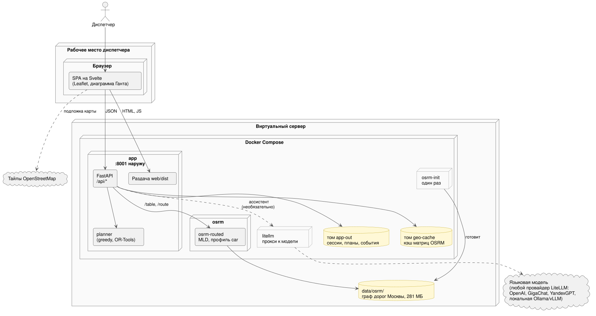
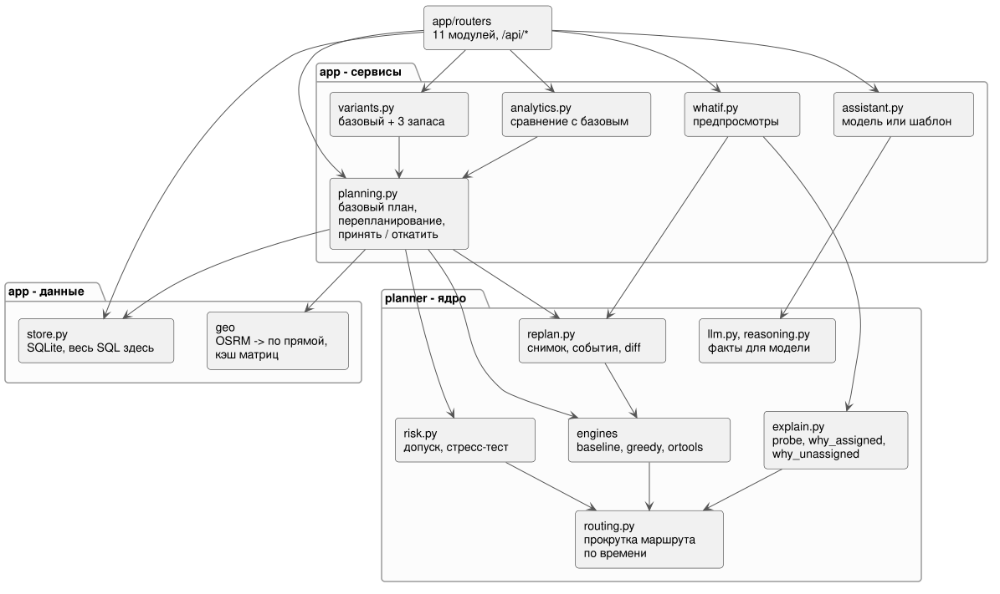
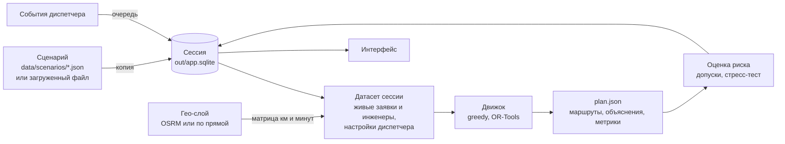
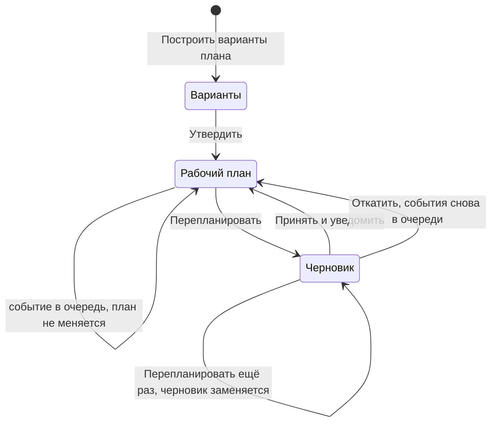
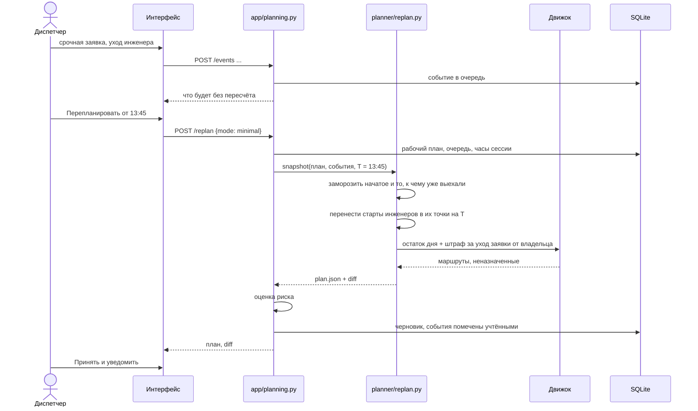
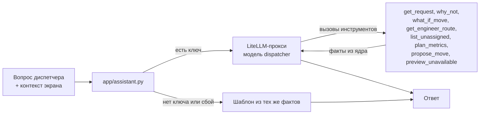

# Архитектура

Серверная часть - три сервиса Docker Compose на одном виртуальном сервере, поднимаются одной командой.
Наружу смотрит только приложение. Диспетчер работает в браузере на своём рабочем месте.

- **Приложение** (`app/`, порт 8001). FastAPI отдаёт `/api/*` и собранный фронт из `web/dist`.
  Решение задачи идёт в том же процессе: ядро `planner/` подключено как обычный пакет.
- **OSRM** (`osrm-routed` из официального образа). Дороги Москвы из OpenStreetMap: километры и минуты
  между всеми точками одним запросом `/table`, геометрия участков для карты через `/route`. Граф
  дорог один раз готовит вспомогательный сервис `osrm-init`.
- **LiteLLM-прокси** (из того же образа, что и приложение). Через него ассистент ходит к модели. Ключ
  провайдера хранится только в прокси; приложение знает адрес прокси и свой ключ к нему.

Как это запускается, описано в [deployment.md](deployment.md).

Один сервер и одна база SQLite - осознанный выбор под масштаб задачи: один округ, один диспетчер. Разносить
это на сервисы незачем. Граница, которая действительно важна, проходит между ядром и приложением.

## Ядро и приложение

`planner/` ничего не знает о HTTP, базе и сессиях. На вход он получает датасет (JSON: инженеры, заявки,
конфиг, матрица расстояний), на выход отдаёт `plan.json`: маршруты, назначения с объяснениями, метрики, а
при перепланировании ещё diff со старым планом. Поэтому ядро можно гонять из командной строки
(`python3 -m planner solve ...`) и тестировать без поднятого сервера. Так оно и разрабатывалось, до
всякого интерфейса.

`app/` - мост. Он собирает датасет сессии из базы, берёт матрицу у гео-слоя, накладывает настройки
диспетчера, зовёт движок и сохраняет результат. Роутеры тонкие: разобрали запрос, взяли общий замок,
позвали сервис. Весь SQL лежит в `store.py`, и каждая функция там принимает `sid`, так что фильтр по
сессии просто негде забыть.

`web/` - одностраничное приложение на Svelte 5. Оно ничего не считает само, кроме раскладки диаграммы:
всё, что показывается диспетчеру, включая тексты объяснений, приходит с сервера.

## Поток данных

Сценарий никогда не меняется. При создании сессии его инженеры и заявки копируются в базу, и дальше
срочные заявки, отмены и уходы живут только в этой сессии. Матрица считается по точкам сценария один раз
и кэшируется на диске (`data/geo/`), поэтому десять сессий одного сценария спрашивают OSRM один раз.
Если диспетчер завёл заявку днём, матрица этой сессии пересчитывается тем же `/table` вместе с новой
точкой и кладётся в кэш под своим ключом, так что до новой заявки время тоже считается по дорогам.
Саму точку новой заявки сервер при сохранении ищет по адресу в Nominatim (`app/geo/geocode.py`); если
не нашёл, остаётся точка из формы: центр района.

## Жизнь плана за день

Главное правило, которое мы держали во всём интерфейсе: **расписание не меняется без «Перепланировать»**.
Событие только встаёт в очередь, а экран сразу показывает, что будет, если оставить план как есть:
сколько заявок останется без исполнителя, есть ли непристроенная срочная, сколько ожидается опозданий.
Ассистент тоже ничего не меняет сам: перенос он может только предложить, в очередь его кладёт человек.

Перепланирование над непринятым черновиком не наращивает цепочку. Оно считает заново от последнего
принятого плана, объединяя события черновика с тем, что пришло после, а сам черновик выбрасывает.
Цепочка принятых планов хранится целиком, и на экране аналитики видно, как менялся день.

## Перепланирование по шагам

## Гео-слой

`app/geo/` прячет, откуда берутся расстояния. Провайдер один, `Osrm`, и внутри у него запасной вариант:

- Для машины километры и минуты приходят из `/table` одним запросом на все пары. Для 71 точки обычного
  дня это доли секунды.
- Для пешехода, велосипеда и общественного транспорта OSRM у нас не считает: на каждый профиль нужен
  свой граф. Их время получается из дорожного километража по средней скорости плюс фиксированная добавка
  (ожидание транспорта, парковка велосипеда).
- Если OSRM не ответил или ответил не то, вся матрица считается по прямой с коэффициентом 1,3. Половину
  матрицы из одного источника, половину из другого мы не отдаём никогда. В ответе API есть поле
  `travel_source`, и карта в этом случае предупреждает, что время в пути оценено по прямой.

В кэш на диске попадает только ответ OSRM. Оценка по прямой запоминается в памяти процесса, чтобы
каждый запрос не ждал таймаута. Поэтому приложение стартует только после того, как OSRM ответил на
проверку готовности: иначе первые сценарии застряли бы на оценке по прямой до перезапуска.

Линии на карте запрашиваются отдельно (`GET /routes`) и только для пар, которые реально есть в плане.
Если матрица оценочная, линии рисуются прямыми, OSRM не спрашивается.

## Хранение

Одна база `out/app.sqlite`, пять таблиц, документы лежат как JSON:

| Таблица | Что в ней |
|---|---|
| `sessions` | сценарий, часы сессии, настройки, текущий план |
| `engineers` | инженеры сессии |
| `requests` | заявки сессии, включая срочные, добавленные днём |
| `events` | события; `applied_plan_id` пуст, пока событие в очереди |
| `plans` | все планы сессии: варианты, базовый, перепланирования, с оценкой риска |

ORM здесь нет: схемы документов ещё менялись, а запросы простые. SQLite не любит одно соединение на
несколько потоков, поэтому у каждого потока пула FastAPI своё соединение. Расчёты идут под одним общим
замком: два перепланирования одной сессии параллельно не пойдут.

## Ассистент

Модель не видит план целиком и ничего не знает о нём, кроме того, что вернули инструменты. Сказать
«Петров занят», не вызвав функцию, которая это проверила, она не может. Инструменты - те же функции, на
которых построены карточка заявки и предпросмотры, так что ответ ассистента и то, что нарисовано на
экране, расходиться не должны.

Приложение не привязано к провайдеру: оно знает только имя `dispatcher`, а что за ним стоит, решает
`litellm_config.yaml`. Сейчас там `openai/gpt-6-luna` с малым усилием рассуждения, чтобы ответ приходил
за несколько секунд. Это выбор команды, а не требование архитектуры. В том же конфиге лежат готовые
блоки для локальной модели (Ollama, vLLM), GigaChat, YandexGPT и других облаков. От модели нужно одно:
умение вызывать инструменты.

## API

Все адреса начинаются с `/api`. Интерактивная документация FastAPI доступна по `/docs`.

| Метод и путь | Что делает |
|---|---|
| `GET /scenarios`, `POST /scenarios/upload` | встроенные сценарии; загрузка своего CSV или JSON |
| `POST /sessions`, `GET /sessions`, `GET /sessions/{sid}` | создать сессию, список, состояние |
| `GET, PUT /sessions/{sid}/settings` | запас, «что важнее», движок, время расчёта |
| `PUT /sessions/{sid}/clock` | часы сессии |
| `POST, GET /sessions/{sid}/variants`, `POST .../variants/{pid}/approve` | варианты плана и утверждение |
| `POST, GET /sessions/{sid}/plan` | базовый план на весь день; текущий план со всем для отрисовки |
| `POST /sessions/{sid}/replan`, `.../plan/accept`, `.../plan/rollback` | перепланировать, принять, откатить |
| `GET /sessions/{sid}/history` | цепочка планов дня |
| `GET /sessions/{sid}/explain/{rid}` | объяснение заявки |
| `GET /sessions/{sid}/routes` | геометрия маршрутов для карты |
| `GET /sessions/{sid}/engineers`, `.../requests`, `.../catalog` | справочники сессии |
| `POST .../requests` | новая (в том числе срочная) заявка |
| `POST .../requests/{rid}/cancel`, `.../requests/{rid}/move` | отмена, ручной перенос |
| `POST .../engineers/{eid}/unavailable` | уход, отсутствие, перерыв |
| `DELETE .../events/{eid}` | убрать событие из очереди |
| `GET .../impact` | что будет, если не перепланировать |
| `POST .../preview/request`, `.../preview/unavailable/{eid}` | кто успеет взять новую заявку; что освободится при уходе |
| `GET .../analytics` | текущий план против базового варианта на тех же вводных |
| `POST .../assistant` | вопрос ассистенту |

## Интерфейс

Svelte 5, Vite, Leaflet для карты, своя диаграмма Ганта на SVG. Экранов семь: сценарии, настройка
и варианты, план (диаграмма и карта), инженеры, заявки, аналитика. Плюс модальные окна событий и
боковая панель ассистента. Рассчитан на экран рабочего места от 1440 пикселей по ширине. Как это выглядит, показано в
[preview.md](preview.md).

Состояние экрана живёт в адресе (`/s/{sid}/plan/map`), так что страницу можно перезагрузить или открыть
в соседней вкладке и попасть туда же.
