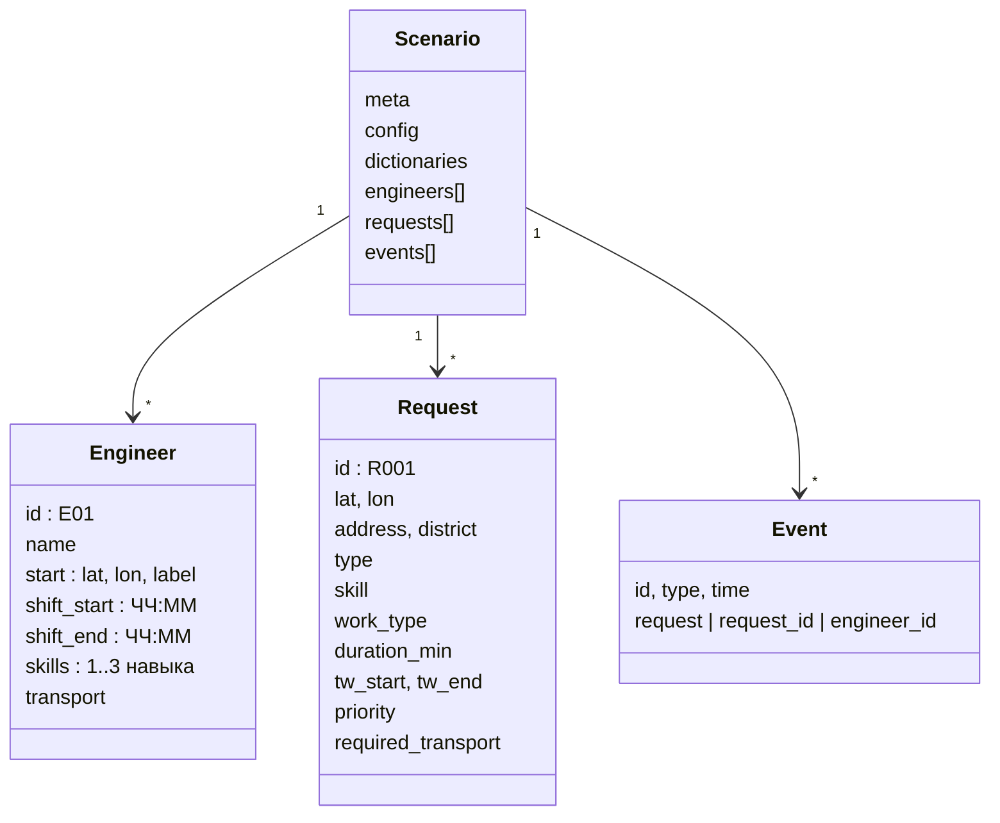

# Данные

## Откуда данные

От заказчика пришли семь CSV по трём направлениям (Восток, Юго-восток, Югоцентр): синтетические
заявки на один день, 17.08.2026, и «контрольное распределение» - как те же заявки раскидали по бригадам
вручную. Файлы в cp1251, разделитель точка с запятой, в каждом 55-85 заявок:

```
Заявка;Тип заявки BK;Тип заявки HD;Начало;Окончание;Район;Адрес;Подключение;Гигабитное подключение
74198;Подключение;Конвергенция абонента;17.08.2026 20:00;17.08.2026 22:00;Кузьминки;Город Москва, пр-кт.Волгоградский, д. 128 к 5;FMC;Нет
```

Для задачи этого мало. Нет координат, нет длительностей, нет навыков и транспорта, а главное - нет самих
инженеров с их сменами. Всё это пришлось бы придумывать в любом случае. Поэтому мы сделали свой
синтетический набор сразу в формате модели, взяв из реальных файлов всё, что в них есть: районы,
улицы, типы заявок, двухчасовые окна, распределение заявок по времени дня. Длительности взяты из
нормативов заказчика (`Нормативы.xlsx`). Генератор - `data/synth/generate.py`, он детерминирован
(фиксированный seed).

Условие просит, чтобы в наборе встречались все три навыка, разные комбинации навыков у инженеров, все
виды транспорта, пересекающиеся окна и хотя бы один конфликт, где последовательное распределение
проигрывает. Всё это есть, а `generate.py --check` проверяет покрытие и печатает сравнение с
последовательным распределением.

## Три сценария

| Сценарий | Инженеров | Заявок | Зачем |
|---|---|---|---|
| Обычный день (`normal`) | 12 | 59 | штатная нагрузка, почти всё назначается |
| Пиковая нагрузка (`peak`) | 12 | 78 | заявок больше при том же составе, часть не помещается |
| Некомплект (`short-staffed`) | 8 | 59 | обычный объём силами восьми человек, риск опозданий |

География у всех одна: девять районов ЮАО без Подмосковья. Это Царицыно, Москворечье-Сабурово,
Орехово-Борисово Северное и Южное, Зябликово, Братеево, Бирюлёво Восточное и Западное, Чертаново
Южное. Поперёк зона около 11 км. Офис на Бирюлёвской, 1с1. По условию диспетчер планирует на округ,
поэтому выездов через весь город в данных нет.

Координаты синтетические: центроид района плюс случайный сдвиг до полутора километров. Адрес - реальная
улица этого района и случайный номер дома. К координатам адрес привязан только районом, геокодированием
мы не занимались.

## Единицы

| Величина | Формат |
|---|---|
| время суток | `"ЧЧ:ММ"`, в коде - минуты от полуночи |
| длительность, время в пути, запас | минуты, целые |
| расстояние | километры |
| координаты | широта и долгота, WGS-84 |

## Формат сценария

Один JSON-файл. Его же можно загрузить в интерфейсе как свой набор.



### Инженер

| Поле | Тип | Пример | Смысл |
|---|---|---|---|
| `id` | строка | `E01` | |
| `name` | строка | `Горбанев` | фамилия, так диспетчер и говорит |
| `start.lat`, `start.lon` | число | `55.604`, `37.664` | откуда выезжает |
| `start.label` | строка | `Офис, ул. Бирюлёвская, д. 1с1` | подпись точки старта |
| `shift_start`, `shift_end` | ЧЧ:ММ | `09:00`, `18:00` | смена |
| `skills` | список | `["local", "connect"]` | от одного до трёх навыков |
| `transport` | строка | `car` | ключ из справочника транспорта |

### Заявка

| Поле | Тип | Пример | Смысл |
|---|---|---|---|
| `id` | строка | `R001` | |
| `lat`, `lon` | число | `55.5987`, `37.6381` | точка визита |
| `address`, `district` | строка | `Бирюлёво Западное, ул. Харьковская, д. 5` | для людей |
| `type` | строка | `Низкая скорость` | подтип из реальных данных, для текста |
| `skill` | строка | `local` | требуемый навык |
| `work_type` | строка | `local_repair` | категория норматива, от неё длительность |
| `duration_min` | число | `30` | можно не указывать: возьмётся из норматива |
| `tw_start`, `tw_end` | ЧЧ:ММ | `16:00`, `18:00` | окно начала работ |
| `priority` | строка | `normal` | `normal` или `urgent` |
| `required_transport` | строка или `null` | `car` | если работа требует транспорта |

### Событие

Ровно один из видов:

```json
{"id": "EV1", "type": "urgent_request", "time": "13:30", "request": {"id": "R901", "priority": "urgent", "...": "..."}}
{"id": "EV2", "type": "cancel_request", "time": "12:15", "request_id": "R002"}
{"id": "EV3", "type": "engineer_unavailable", "time": "14:00", "engineer_id": "E01", "finish_current": true}
```

В файлах сценариев лежит по три таких события, это пример для командной строки. В приложении сессия
начинается без событий: их заводит диспетчер. Там же есть ещё два вида - перерыв инженера и ручной
перенос заявки.

## Справочники

**Навыки**

| Ключ | Название |
|---|---|
| `local` | Локальные работы |
| `connect` | Работы на подключение и дозаказы |
| `emergency` | Аварийные работы |

**Транспорт**

| Ключ | Название | Средняя скорость | Добавка на переезд |
|---|---|---|---|
| `car` | Автомобиль | 25 км/ч (без OSRM) | 5 мин, парковка |
| `bike` | Велосипед | 15 км/ч | 2 мин |
| `foot` | Пешеход | 5 км/ч | 0 |
| `public` | Общественный транспорт | 18 км/ч | 10 мин, ожидание |

С поднятым OSRM время для машины берётся из него, скорость из таблицы не нужна.

**Нормативы** (из `Нормативы.xlsx`, длительность = техработы + документы)

| `work_type` | Название | Техработы | Документы | Итого у клиента |
|---|---|---|---|---|
| `connect_base` | Подключение клиентов, базовая | 60 | 10 | 70 мин |
| `emergency` | Авария на ТКД | 80 | 0 | 80 мин |
| `equipment` | Дозаказ оборудования | 10 | 10 | 20 мин |
| `local_repair` | Локальная заявка, ремонт у клиента | 30 | 0 | 30 мин |

В нормативах есть и «дорога 20 минут». Мы её не используем, вместо неё считаем реальную дорогу. Но в
командной строке есть режим `--travel normative`, где каждый переезд стоит ровно 20 минут, как при
ручном планировании сейчас. Он полезен для сравнения.

**Подтипы заявок**

| `type` | Навык | Норматив | Транспорт |
|---|---|---|---|
| Подключение (конвергенция), Заявка на подключение, Переключение на Гбит/с | connect | connect_base | любой |
| Дозаказ оборудования | connect | equipment | car |
| Нет линка, Низкая скорость, Замена роутера, Замена ТВ-приставки | local | local_repair | любой |
| Работа с кабелем | local | local_repair | car |
| Авария на узле, Обрыв магистрали | emergency | emergency | car |
| Рост ошибок на порту | emergency | emergency | любой |

Машина требуется там, где везут оборудование или инструмент.

## Инженеры обычного дня

| id | Фамилия | Транспорт | Смена | Навыки | Старт |
|---|---|---|---|---|---|
| E01 | Горбанев | car | 09-18 | local, connect, emergency | офис |
| E02 | Паршин | car | 09-18 | connect | офис |
| E03 | Саламатин | car | 12-21 | local, connect | офис |
| E04 | Козырь | foot | 09-18 | local | дом, Царицыно |
| E05 | Белоновский | car | 13-22 | local, connect | офис |
| E06 | Рыбин | bike | 11-20 | local, connect | дом, Зябликово |
| E07 | Андреев | car | 13-22 | connect, emergency | офис |
| E08 | Бузань | public | 13-22 | connect | офис |
| E09 | Макаров | car | 09-18 | local, emergency | офис |
| E10 | Царьков | public | 13-22 | local | дом, Братеево |
| E11 | Демин | car | 13-22 | local, connect, emergency | офис |
| E12 | Каушнян | foot | 10-19 | emergency | офис |

Все семь комбинаций навыков, все четыре вида транспорта, три типа смен. В некомплекте остаются первые
восемь, E01-E08.

## Заявки и встроенные конфликты

Обычные заявки R001-R055 раскиданы по районам с весами и по слотам с фиксированной квотой: 10-12 - 7,
12-14 - 9, 14-16 - 13, 16-18 - 12, 18-20 - 8, 20-22 - 6. Квота нужна, чтобы нагрузка не зависела от
случайности. 40 % аварий получают широкое окно 10:00-22:00. По каждому слоту нагрузка 50-65 %
ёмкости смен, остальное уходит на дорогу.

Несколько заявок добавлены руками, чтобы проверить конкретное поведение:

| Заявка | Что в ней | Что должно получиться |
|---|---|---|
| R056 | подключение в пешеходной зоне: навык connect, транспорт foot | не назначена: пеших с навыком подключения нет |
| R057 | авария 80 минут, клиент ждёт только 21:00-22:00, смены до 22:00 | не назначена: не помещается в смену |
| R058, R059 | обе в Братеево, на краю округа, окно 14:00-16:00 | выгодно отдать одному инженеру |

В пике те же заявки идут под номерами R075-R078.

Кода `WINDOW_REACH` («не успевает доехать до конца окна») в компактном округе на старте дня не бывает,
и это нормально. Он появляется при перепланировании: срочная заявка с коротким окном, а все, кто может
её взять, далеко.

Главный конфликт для сравнения с базовым вариантом возникает сам собой. Инженеры со сменой 09-18 стоят в
начале списка, и последовательное распределение забивает им хвосты маршрутов вечерними заявками, после
чего утренние им уже не достаются. Отсюда 33 назначенных заявки из 59 против 57 у оптимизатора.

## Свой набор данных

На главном экране есть кнопка «Загрузить CSV / JSON».

**JSON** - файл в формате сценария выше. Обязательны списки `engineers` и `requests`. Если `config` и
`dictionaries` нет или они неполные, недостающее берётся из выбранного базового сценария.

**CSV** - только заявки, инженеры берутся из базового сценария. Разделитель - точка с запятой или
запятая, определяется сам. Кодировка UTF-8 или cp1251.

| Колонка | Обязательна | Пример |
|---|---|---|
| `id` | нет, иначе R001, R002... | `R001` |
| `lat`, `lon` | да | `55.6187`, `37.7094` |
| `address`, `district` | да | `ул. Домодедовская, д. 27`, `Орехово-Борисово Северное` |
| `type` | да | `Нет линка` |
| `work_type` | да | `local_repair`; навык выводится из него |
| `tw_start`, `tw_end` | да | `14:00`, `16:00` |
| `priority` | нет | `normal` |
| `required_transport` | нет | `car` |

```csv
id;lat;lon;address;district;type;work_type;tw_start;tw_end;priority;required_transport
R001;55.6187;37.7094;ул. Домодедовская, д. 27;Орехово-Борисово Северное;Нет линка;local_repair;14:00;16:00;normal;
R002;55.6360;37.7620;ул. Братеевская, д. 10;Братеево;Обрыв магистрали;emergency;10:00;22:00;normal;car
```

Файл проверяется целиком, теми же правилами, что и форма новой заявки: формат времени, окно не
пустое, точка внутри Московской агломерации (граф OSRM собран на неё), известный вид работ, номера не
повторяются. Ошибки показываются списком, до двадцати сразу, с номерами строк.

## Результат: `plan.json`

Любой движок возвращает один формат. Ниже сокращённый вывод greedy на обычном дне; у каждой заявки
есть ещё готовый текст объяснения в поле `text`.

```json
{
  "plan_id": "45f3c6bf",
  "engine": "greedy",
  "dataset": "normal",
  "solve_time_s": 0.2,
  "replan_of": null,
  "now": null,
  "routes": [
    {
      "engineer_id": "E01", "name": "Горбанев", "transport": "car",
      "start": {"node": "E01", "label": "Офис, ул. Бирюлёвская, д. 1с1"},
      "available_from": "09:00",
      "stops": [
        {"request_id": "R017", "seq": 1, "arrive": "09:05", "start": "10:00", "finish": "10:20",
         "wait_min": 55, "leg_km": 2.55, "leg_min": 5, "slack_min": 120, "locked": false}
      ],
      "total_km": 28.8, "total_work_min": 370, "total_travel_min": 53, "utilization": 0.78
    }
  ],
  "assignments": {
    "R017": {
      "engineer_id": "E01",
      "reason": {
        "constraints_ok": ["SKILL", "TRANSPORT", "WINDOW", "SHIFT"],
        "position": {"seq": 1, "prev_request_id": null, "next_request_id": "R047"},
        "arrive": "09:05", "start": "10:00", "wait_min": 55, "slack_min": 120, "delta_km": 5.1,
        "alternatives": [
          {"engineer_id": "E02", "feasible": true, "delta_km": 2.5, "best_position": 0},
          {"engineer_id": "E04", "feasible": false, "blocker": {"code": "SKILL", "text": "нет нужного навыка"}}
        ]
      }
    },
    "R056": {
      "engineer_id": null,
      "reason": {"code": "TRANSPORT", "no_candidates": true,
                 "compat": {"E01": "TRANSPORT", "E04": "SKILL", "...": "..."}, "probes": []}
    }
  },
  "unassigned": ["R056", "R057"],
  "metrics": {
    "engineers_used": 8, "engineers_total": 12,
    "assigned": 57, "unassigned": 2, "urgent_unassigned": 0,
    "total_km": 209.0, "km_per_engineer": {"E01": 28.8, "E02": 0, "...": 0},
    "total_travel_min": 488, "total_wait_min": 738
  },
  "diff": null
}
```

У перепланирования заполнены `replan_of` и `diff`, а у остановок, которые были заморожены, стоит
`"locked": true`. Приложение добавляет к плану оценку риска: допуск каждой остановки и результат
стресс-теста.
