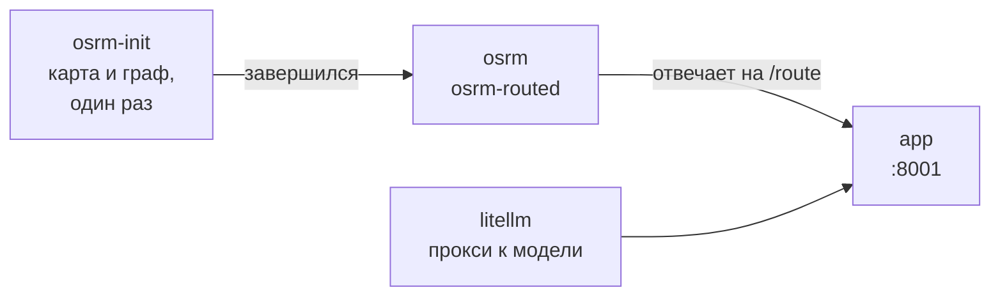

# Установка и запуск

## Что нужно

| Что | Версия | Зачем |
|---|---|---|
| Docker с Compose v2 | любая свежая | весь прототип: приложение, OSRM, прокси к модели |
| Память для Docker | 4 ГБ на первый запуск | подготовка графа дорог; дальше OSRM занимает около 150 МБ |
| Место на диске | ~300 МБ плюс образы | карта Москвы и подготовленный граф дорог |
| Интернет | при первом запуске | образы, карта для OSRM, подложка карты в браузере |
| Языковая модель | необязательно | ассистент; подойдёт облачная или локальная, без неё ответы шаблонные |

Python и Node на сервер ставить не нужно: фронт собирается внутри образа.

## Запуск

```bash
cp .env.example .env          # ключи для ассистента; можно оставить пустыми
docker compose up -d          # http://localhost:8001
```

Всё. Документация API лежит по адресу http://localhost:8001/docs.

Первый запуск занимает несколько минут, дальше стек поднимается за секунды. Compose сам соблюдает
порядок: пока не готов граф дорог, OSRM не стартует, а приложение ждёт, пока OSRM не начнёт отвечать.



## Что внутри

| Сервис | Образ | Что делает |
|---|---|---|
| `osrm-init` | `ghcr.io/project-osrm/osrm-backend:v6.0.0` | готовит граф дорог и завершается |
| `osrm` | тот же | `osrm-routed` для профиля car, только внутри сети compose |
| `litellm` | собирается из `Dockerfile` | прокси к модели с `litellm_config.yaml` |
| `app` | собирается из `Dockerfile` | FastAPI и собранный фронт, порт 8001 наружу |

`Dockerfile` двухэтапный. На первом этапе `node:22-slim` собирает `web/dist`, на втором
`python:3.12-slim` ставит `requirements.txt` и копирует `app/`, `planner/`, встроенные сценарии и
собранный фронт. Прокси запускается из того же образа: так версия LiteLLM у прокси и у приложения
всегда совпадает. С разными версиями мы уже ловили отказ модели на параметре `max_tokens`.

Наружу открыт только порт приложения. OSRM и прокси доступны лишь соседям по сети compose, и
приложение ходит к ним по именам сервисов: `http://osrm:5000` и `http://litellm:4000`.

### Граф дорог

`osrm-init` выполняет `docker/osrm-init.sh`. Если в `data/osrm/` чего-то не хватает, скрипт:

1. Скачивает выгрузку OpenStreetMap «Moscow» с BBBike, это около 85 МБ: город и ближнее Подмосковье.
2. Готовит граф дорог для профиля car алгоритмом MLD: `osrm-extract`, `osrm-partition`,
   `osrm-customize`. У нас это заняло около 40 секунд.

Если всё на месте, скрипт сразу завершается. Каталог `data/osrm/` привязан к хосту и весит 281 МБ.
В git он не попадает, а после `docker compose down` остаётся на месте. Чтобы подготовить граф заново
на свежих дорогах, удалите каталог и поднимите стек:

```bash
rm -rf data/osrm && docker compose up -d
```

Лимит `/table` поднят до 1000 точек (`--max-table-size 1000`): по умолчанию он 100, а в загруженном дне
точек бывает больше.

### Данные

База сессий `out/app.sqlite` и загруженные наборы данных `out/scenarios/` лежат в томе `app-out`,
кэш матриц расстояний `data/geo/` лежит в томе `geo-cache`. Оба тома переживают `docker compose down`
и пересборку образа.

### Прокси к модели

Приложение не пользуется SDK провайдеров напрямую. Оно ходит через `litellm.completion` с моделью
`litellm_proxy/dispatcher` и не знает, кто стоит за этим именем. Это решает `litellm_config.yaml`.

Сейчас `dispatcher` указывает на `openai/gpt-6-luna`: этой моделью пользовалась команда, и только.
LiteLLM работает с сотней провайдеров, и в конфиге рядом лежат закомментированные блоки для самых
вероятных замен:

| Вариант | Строка `model` | Что нужно |
|---|---|---|
| Локально через Ollama | `ollama_chat/qwen3:14b` | Ollama на том же сервере, ключ не нужен |
| Локально через vLLM или другой OpenAI-совместимый сервер | `hosted_vllm/Qwen/Qwen3-32B` | адрес сервера в `api_base` |
| GigaChat | `gigachat/GigaChat-2-Max` | `GIGACHAT_CREDENTIALS` |
| YandexGPT | `openai/gpt://<folder_id>/yandexgpt/latest` | `YANDEX_API_KEY`, `api_base` Yandex Cloud |
| Anthropic, Gemini, Mistral, DeepSeek и другие | `anthropic/...`, `gemini/...` и т.д. | ключ провайдера |

Чтобы сменить модель:

1. Закомментируйте текущий блок `dispatcher` и раскомментируйте нужный.
2. Положите ключ провайдера в `.env`, если он нужен.
3. Выполните `docker compose up -d`: прокси подхватит конфиг и ключи. Если менялся только конфиг,
   хватит `docker compose restart litellm`.

Код приложения при этом не меняется. Модель должна уметь вызывать инструменты (function calling):
без этого ассистент не может заглянуть в план. Локальная модель на том же сервере доступна прокси
по адресу `host.docker.internal`, это прописано в `docker-compose.yml`.

## Переменные окружения

Все задаются в `.env`, шаблон с комментариями лежит в `.env.example`.

| Переменная | По умолчанию | Что это |
|---|---|---|
| `OPENAI_API_KEY`, `GIGACHAT_CREDENTIALS`, `YANDEX_API_KEY` и т.п. | нет | ключ того провайдера, что выбран в `litellm_config.yaml`; читает только прокси |
| `LITELLM_MASTER_KEY` | нет | любой секрет: им приложение авторизуется у прокси; без него ответы шаблонные |
| `LLM_MODEL` | `dispatcher` | имя модели из конфига прокси |
| `APP_PORT` | `8001` | на каком порту хоста доступно приложение |
| `GEOCODER_URL` | `https://nominatim.openstreetmap.org` | геокодер адресов новых заявок, API Nominatim; `off` выключает |

Адреса OSRM и прокси (`OSRM_URL`, `LITELLM_BASE_URL`) задаёт `docker-compose.yml`, трогать их нужно
только при запуске без Docker.

## Управление

```bash
docker compose ps                   # что запущено и здорово ли
docker compose logs -f app          # логи приложения
docker compose up -d --build        # пересобрать образ после правок кода
docker compose down                 # остановить; граф и тома остаются
docker compose down -v              # остановить и стереть сессии и кэш матриц
```

## Разработка без Docker

Для правок кода удобнее запускать приложение прямо на машине. Нужны Python 3.11+ и Node 20+, OSRM и
прокси можно оставить в Docker, открыв их порты, или обойтись без них.

```bash
pip3 install -r requirements.txt
npm --prefix web install
python3 -m uvicorn app.main:app --port 8001 --reload
npm --prefix web run dev            # http://localhost:5173, Vite проксирует /api на :8001
```

Без Docker адреса берутся из `OSRM_URL` (по умолчанию `http://localhost:5001`) и `LITELLM_BASE_URL`
(по умолчанию `http://localhost:4000`). Если OSRM не отвечает, расстояния считаются по прямой.

## Тесты

```bash
python3 -m pytest -q                # 310 тестов: ядро, API, гео-слой
npm --prefix web test               # 133 теста логики интерфейса (vitest)
node web/scripts/walk.mjs           # весь день в Chrome на трёх сценариях, скриншоты в out/screens/
```

Для pytest не нужны ни OSRM, ни модель: гео-слой подменяется оценкой по прямой, ассистент - шаблоном.
`walk.mjs` ходит в запущенное приложение (адрес в `APP_URL`, по умолчанию `http://127.0.0.1:8001`) и
падает на первой ошибке в консоли браузера.

## Командная строка

Ядро можно гонять без сервера. Все команды работают со встроенным синтетическим датасетом
`data/synth/dataset.json` и пишут результаты в `out/`:

```bash
python3 data/synth/generate.py --check                       # пересоздать датасет и проверить покрытие
python3 -m planner solve --engine all                        # baseline, greedy, ortools
python3 -m planner compare out/plan_baseline.json out/plan_greedy.json out/plan_ortools.json
python3 -m planner replan out/plan_ortools.json --event EV1 --event EV3 --engine ortools
python3 -m planner explain out/plan_ortools.json R033        # почему назначена или нет
python3 -m planner verify out/*.json                         # независимая проверка всех ограничений
python3 -m planner risk out/plan_ortools.json --stress-only  # допуски и стресс-тест
python3 -m planner narrate out/plan_ortools.json --summary   # текст через модель
python3 -m planner chat out/plan_ortools.json --ask "почему R033 не у Царькова?"
```

`verify` не использует движки и перепроверяет план с нуля: навыки, транспорт, окна, смены, согласованность
времени.

Командная строка считает расстояния по прямой с коэффициентом 1,3: OSRM подключён только в приложении.

## Если что-то не так

**`docker compose up` падает на `osrm-init`.** Скорее всего, Docker не хватило памяти на подготовку
графа. Дайте ему 4 ГБ в настройках Docker Desktop, удалите недоделанный `data/osrm/` и запустите снова.
Что именно случилось, покажет `docker compose logs osrm-init`.

**На карте надпись «оценка по прямой: сервис дорог недоступен».** OSRM не ответил, когда приложение
строило матрицу. Проверьте `docker compose ps`: у `osrm` должно быть `healthy`. Затем
`docker compose restart app`.

**Ассистент отвечает шаблоном.** В `.env` нет ключей или прокси не поднялся. Проверьте `.env` и
`docker compose logs litellm`, после правки `.env` выполните `docker compose up -d`. Шаблонные ответы -
это нормальный режим, а не ошибка.

**Порт 8001 занят.** Укажите другой в `.env`: `APP_PORT=8002`, и `docker compose up -d`.

**Нужно начать с чистого листа.** `docker compose down -v`: все сессии и кэш матриц пропадут,
встроенные сценарии и граф дорог останутся.
