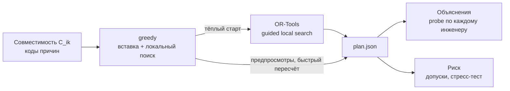
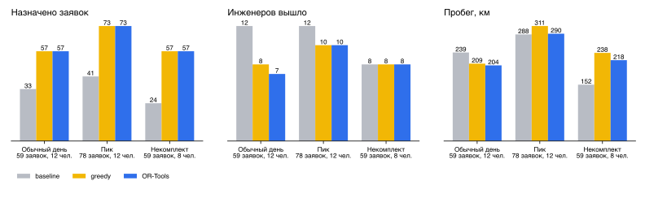

# Модель оптимизации

С точки зрения исследования операций это задача маршрутизации нескольких транспортных средств с
временными окнами (VRPTW) с парой особенностей. Машины разнородны: у каждого инженера свои навыки, свой
транспорт и своя смена. Возвращаться в депо не нужно. Заявки можно не назначать, но за это назначен
большой штраф. Сама по себе задача NP-трудная, но на наших размерах (до 100 заявок и 15 инженеров)
хорошие решения находятся за секунды.

Ниже сначала модель целиком, потом то, как её решают три движка, а в конце перепланирование, запас
времени и объяснения. Код лежит в `planner/`, и имена ограничений в комментариях там совпадают с
метками ниже: (A1), (T3), (L2) и так далее.

## Обозначения

**Множества**

| Символ | Смысл |
|---|---|
| $R$ | заявки, индекс $i$ или $j$ |
| $E$ | инженеры, индекс $k$ |
| $Q$ | навыки: `local`, `connect`, `emergency` |
| $M$ | виды транспорта: `car`, `foot`, `bike`, `public` |
| $s_k$ | стартовая точка инженера $k$: офис или дом |
| $0$ | фиктивный конец маршрута: в офис никто не возвращается |

**Параметры заявки** $i \in R$

| Символ | Смысл | Единицы |
|---|---|---|
| $a_i, b_i$ | окно: начать работу нужно не раньше $a_i$ и не позже $b_i$ | минуты от полуночи |
| $p_i$ | длительность работы по нормативу для её типа | минуты |
| $q_i \in Q$ | требуемый навык | |
| $v_i \in M$ или $\varnothing$ | требуемый транспорт, если есть (оборудование везут на машине) | |
| $w_i$ | вес приоритета: 1 для обычной, 3 для срочной | |

**Параметры инженера** $k \in E$

| Символ | Смысл |
|---|---|
| $\alpha_k, \beta_k$ | начало и конец смены, минуты от полуночи |
| $S_k \subseteq Q$ | навыки, от одного до трёх |
| $m_k \in M$ | транспорт |

**Расстояния.** $d_{ij}$ - дорожное расстояние в километрах, $\tau^{m}_{ij}$ - время в пути в целых
минутах для транспорта $m$. Для машины оба числа приходят из OSRM. Для остальных видов время
получается из дорожного километража:

$$
\tau^{m}_{ij} = \frac{60 \, d_{ij}}{v^{m}} + c^{m},
\qquad v = (25,\ 15,\ 5,\ 18)\ \text{km/h},
\qquad c = (5,\ 2,\ 0,\ 10)\ \text{min}
$$

для `car`, `bike`, `foot`, `public` соответственно. Добавка $c^m$ - парковка машины или ожидание
транспорта. Без OSRM вместо $d_{ij}$ берётся расстояние по прямой, умноженное на 1,3, и формула
применяется ко всем видам, включая машину.

## Совместимость

До запуска солвера для каждой пары «заявка - инженер» считается, может ли инженер взять заявку хотя бы
теоретически, с пустым маршрутом:

$$
C_{ik} =
[\, q_i \in S_k \,] \cdot
[\, v_i = \varnothing \ \lor\ v_i = m_k \,] \cdot
[\, e_{ik} \le b_i \,] \cdot
[\, e_{ik} + p_i \le \beta_k \,],
\qquad
e_{ik} = \max\!\left(\alpha_k + \tau^{m_k}_{s_k i},\ a_i\right)
$$

Здесь $[\cdot]$ - индикатор, а $e_{ik}$ - самое раннее время, когда инженер может начать работу. Каждый
из четырёх множителей даёт свой код причины, и если $C_{ik} = 0$, объяснение называет первый сломанный:
`SKILL`, `TRANSPORT`, `WINDOW_REACH`, `SHIFT_FIT`. Если у заявки нет ни одного совместимого
инженера, в солвер она не идёт вовсе и сразу получает объяснение.

## Переменные

$$
\begin{aligned}
x_{ijk} &\in \lbrace 0, 1 \rbrace && \text{инженер } k \text{ едет из } i \text{ в } j \\
y_{ik} &\in \lbrace 0, 1 \rbrace && \text{заявка } i \text{ назначена инженеру } k \\
u_{i} &\in \lbrace 0, 1 \rbrace && \text{заявка } i \text{ не назначена} \\
z_{k} &\in \lbrace 0, 1 \rbrace && \text{инженер } k \text{ задействован} \\
t_{i} &\ge 0 && \text{начало работы на заявке } i
\end{aligned}
$$

## Целевая функция

$$
\min \;
P \sum_{i \in R} w_i \, u_i
\;+\; F \sum_{k \in E} z_k
\;+\; \sum_{k \in E} \sum_{i,j} d_{ij} \, x_{ijk}
\;+\; G \sum_{i \in R^{0}} \left( 1 - y_{i,\,k^{0}_i} \right)
$$

Четыре слагаемых по убыванию важности:

1. Невыполненные заявки со штрафом $P = 10\,000$, срочная весит втрое больше.
2. Число задействованных инженеров с весом $F$.
3. Суммарный пробег в километрах.
4. Только при перепланировании: сколько заявок ушло от прежнего владельца $k^0_i$. Здесь $R^0$ - заявки,
   у которых он был, вес $G = 15$.

Все веса выражены в километрах, поэтому их легко читать. $F = 60$ значит: ещё одного инженера стоит
выводить, только если это экономит больше 60 км на всех. $G = 15$ значит: перекидывать заявку другому
человеку имеет смысл, если выигрыш больше 15 км. Звонок инженеру с новостью «у тебя поменялся план»
тоже чего-то стоит. Штраф $P$ на два порядка больше любых разумных пробегов, так что заявку
солвер бросит, только если её действительно некуда поставить.

$F$ диспетчер выбирает на экране настройки одной радиокнопкой «что важнее»:

| Выбор на экране | $F$ | Смысл |
|---|---|---|
| Меньше инженеров | 200 | человек дороже 200 км, план стягивается на минимум людей |
| Баланс | 60 | по умолчанию |
| Меньше пробега | 10 | людей не жалко, лишь бы короче |

Сами веса в интерфейсе не видны. Диспетчер выбирает смысл, а не коэффициент.

### Две обязательные метрики

Условие требует сравнивать планы по двум метрикам. Обе считаются одной функцией для любого движка:

$$
N = \sum_{k \in E} z_k,
\qquad
L_k = \sum_{i,j} d_{ij} \, x_{ijk} \quad \forall k \in E
$$

$N$ - сколько инженеров вышло на заявки, $L_k$ - пробег каждого. На экране показываются $N$, сумма
$\sum_k L_k$ и $L_k$ по каждому инженеру, а в аналитике рядом стоят те же числа для базового варианта.
Эти метрики входят в целевую функцию лексикографически, через порядок весов: сначала выполнить всё, что
можно, потом меньшим числом людей, потом с меньшим пробегом. Это ровно формулировка условия:
«выполнение всех заявок наименьшим количеством персонала» и «пробег по маршруту каждого исполнителя».

## Ограничения

**Назначение**

$$
\begin{aligned}
&\sum_{k \in E} y_{ik} + u_i = 1 && \forall i \in R && \text{(A1)} \\
&y_{ik} \le C_{ik} && \forall i \in R,\ k \in E && \text{(A2)} \\
&y_{ik} \le z_k && \forall i \in R,\ k \in E && \text{(A3)}
\end{aligned}
$$

Каждая заявка либо у одного инженера, либо не назначена. Назначить можно только совместимому. Инженер с
хотя бы одной заявкой считается задействованным.

**Маршрут**

$$
\begin{aligned}
&\sum_{j} x_{jik} = \sum_{j} x_{ijk} = y_{ik} && \forall i \in R,\ k \in E && \text{(F1)} \\
&\sum_{j \in R} x_{s_k j k} = z_k && \forall k \in E && \text{(F2)} \\
&\sum_{i \in R} x_{i 0 k} = z_k && \forall k \in E && \text{(F3)}
\end{aligned}
$$

Задействованный инженер выезжает со своей стартовой точки и заканчивает где угодно: в фиктивном узле
$0$, до которого дорога ничего не стоит.

**Время**

$$
\begin{aligned}
&x_{ijk} = 1 \;\Rightarrow\; t_j \ge t_i + p_i + \tau^{m_k}_{ij} && \text{(T1)} \\
&x_{s_k i k} = 1 \;\Rightarrow\; t_i \ge \alpha_k + \tau^{m_k}_{s_k i} && \text{(T2)} \\
&a_i \le t_i \le b_i && \text{(T3)} \\
&y_{ik} = 1 \;\Rightarrow\; t_i + p_i \le \beta_k && \text{(T4)}
\end{aligned}
$$

(T1) заодно исключает подциклы: время вдоль маршрута только растёт. (T3) говорит о начале работы:
приехал раньше окна - ждёшь, а закончить можно и после $b_i$. Инженер, приехавший в 13:30 в окно
12:00-14:00 на работу в 70 минут, освободится в 14:40, и это нормально: клиент ждал начала визита в
окне, и визит начался в окне. Так же понимает окно и заказчик. (T4) требует закончить до конца смены.

**Перерывы.** Если у инженера объявлен перерыв $[c, e]$, во время него не идёт ни работа, ни дорога.
В прокрутке маршрута это значит, что выезд, который пересёк бы перерыв, переносится на его конец.

Три группы ограничений из условия, навык, транспорт и время, сидят в (A2) через $C_{ik}$ и в
(T1)-(T4). Больше в модели ничего нет, и это сделано намеренно: условие просит не усложнять.

## Запас времени

Нормативы - это средние. Если строить план впритык, любая задержка на первой заявке тянет за собой все
следующие. Поэтому допустимость плана проверяется на увеличенных длительностях, а в план выводятся
обычные:

$$
p'_i = \operatorname{round}\!\big( p_i \, (1 + \varepsilon_w) \big),
\qquad
\tau'^{m}_{ij} = \operatorname{round}\!\big( \tau^{m}_{ij} \, (1 + \varepsilon_t) + \sigma \big)
$$

$\varepsilon_w$ - запас к работе, $\varepsilon_t$ - к дороге, $\sigma$ - минуты на каждый переезд. Запас
не входит в целевую функцию отдельным слагаемым. Он просто делает часть расписаний недопустимыми, и
солвер сам ищет другие, иногда ценой ещё одного инженера. На экране три готовых профиля:

| Профиль | $\varepsilon_w$ | $\varepsilon_t$ | $\sigma$ |
|---|---|---|---|
| Экономный | 0 | 0 | 0 |
| Сбалансированный | 10 % | 10 % | 2 мин |
| Надёжный | 20 % | 20 % | 5 мин |

Какой взять, подсказывает оценка риска (ниже): экран вариантов считает план для каждого профиля и
показывает, сколько опозданий ожидать от каждого.

## Движки

Все три движка решают одну модель, возвращают один и тот же `plan.json`, и метрики у всех считает одна
функция. Время везде в целых минутах: OR-Tools работает с целыми числами, и если бы наша прокрутка
маршрута считала в дробных, движки расходились бы на округлении.

### Базовый вариант (`baseline`)

Это вариант из условия, с которым мы сравниваемся. Заявки идут в порядке файла. Каждая отдаётся первому
по списку инженеру, у которого она совместима и помещается **в конец** его текущего маршрута. Никакой
оптимизации нет.

Он слаб по понятной причине. Как только у инженера в хвосте маршрута оказалась заявка с окном 20:00-22:00,
ничего более раннего ему уже не достаётся, хотя весь день у него свободен. На обычном дне так получается
33 назначенных заявки из 59 при двенадцати задействованных инженерах.

### Жадная вставка и локальный поиск (`greedy`)

Собственная эвристика на чистом Python, двести строк.

Заявки вставляются по одной в таком порядке: сначала срочные, потом самые «зажатые» (у кого меньше всего
совместимых инженеров), потом с узким окном. Каждая встаёт туда, где прирост стоимости минимален:

$$
\Delta = \Delta L \;+\; F \cdot [\text{маршрут был пуст}] \;+\; G \cdot [\, k \ne k^{0}_i \,]
$$

Потом локальный поиск, пока есть улучшение или не вышло время:

- вставить неназначенные, а если напрямую не лезет, вытеснить одну заявку и переставить её в другое
  место (ejection глубины 1);
- relocate: перенести заявку в лучшее место любого маршрута;
- swap: обменять две заявки между маршрутами;
- 2-opt внутри маршрута;
- попытаться полностью опустошить маршрут, раскидав его заявки по остальным.

Работает за десятые доли секунды. У него три роли: тёплый старт для OR-Tools, быстрый пересчёт для
предпросмотров («кто успеет взять эту заявку», «что освободится, если он уйдёт») и запасной вариант.

### OR-Tools (`ortools`)

Routing Solver из Google OR-Tools. Модель переносится почти дословно:

| Элемент модели | Как в OR-Tools |
|---|---|
| штраф $P w_i$ за неназначенную, (A1) | `AddDisjunction([i], P * w_i)` |
| $F$ за инженера | `SetFixedCostOfAllVehicles(F)` |
| пробег $d_{ij}$ | стоимость дуги для каждого инженера, в метрах |
| $G$ за уход от владельца | добавка к стоимости дуги, входящей в чужую заявку |
| совместимость (A2) | `VehicleVar(i).SetValues([-1] + allowed)` |
| время (T1)-(T4) | размерность `Time` с транзитом $p_i + \tau^{m_k}_{ij}$ по инженеру |
| окно (T3) | `CumulVar(i).SetRange(a_i, b_i)` |
| смена | диапазоны кумулятивов на старте и конце маршрута |
| перерывы | `SetBreakIntervalsOfVehicle` |
| без возврата | все маршруты кончаются в одном фиктивном узле, дуги в него бесплатны |

Первое решение - `PATH_CHEAPEST_ARC`, дальше guided local search в пределах лимита времени (по умолчанию
10 секунд, диспетчер может поставить от 1 до 120). Тёплый старт - решение greedy, прочитанное через
`ReadAssignmentFromRoutes`. В наших замерах он заметно помогал: без него на обычном дне за те же 10 секунд выходило
9 инженеров вместо 8.

Совместимость через `SetAllowedVehiclesForIndex` в Python-биндинге OR-Tools 9.15 у нас не заработала,
поэтому ограничение задано напрямую через домен переменной `VehicleVar`.

### Сравнение на трёх сценариях

Замер: расстояния из OSRM, без запаса, «баланс» ($F = 60$), OR-Tools 10 секунд.

| Сценарий | Движок | Назначено | Инженеров | Пробег | Ожидание у клиентов | Время |
|---|---|---|---|---|---|---|
| Обычный день | baseline | 33 / 59 | 12 | 239 км | 63 ч | 0 с |
| | greedy | 57 / 59 | 8 | 209 км | 12 ч | 0,2 с |
| | OR-Tools | 57 / 59 | **7** | **204 км** | 5 ч | 10 с |
| Пик | baseline | 41 / 78 | 12 | 288 км | 47 ч | 0 с |
| | greedy | 73 / 78 | 10 | 311 км | 8 ч | 0,4 с |
| | OR-Tools | 73 / 78 | 10 | **290 км** | 8 ч | 10 с |
| Некомплект | baseline | 24 / 59 | 8 | 152 км | 41 ч | 0 с |
| | greedy | 57 / 59 | 8 | 238 км | 9 ч | 0,2 с |
| | OR-Tools | 57 / 59 | 8 | **218 км** | 8 ч | 10 с |

Пробег у базового варианта в пике и в некомплекте меньше не потому, что он лучше. Он просто назначил
вдвое меньше заявок: невыполненная заявка ничего не проезжает.

## Перепланирование

Днём приходят события, и в момент $T$ (часы сессии) диспетчер нажимает «Перепланировать». Решается та
же модель, но для остатка дня и с дополнительными условиями:

$$
\begin{aligned}
&i \in \mathcal{L}:\quad y_{i,\,k^{0}_i} = 1,\ \ t_i = t^{0}_i && \text{(L1)} \\
&s_k := \text{точка последней } i \in \mathcal{L} \text{ у } k,\quad \alpha_k := \max\!\left(T,\ t^{0}_{i} + p_i\right) && \text{(L2)} \\
&k \text{ недоступен с } T_k \le T:\quad z_k = 0 && \text{(L3)} \\
&i \text{ отменена}:\quad i \notin R && \text{(L4)} \\
&i \text{ срочная}:\quad i \in R,\ \ w_i = 3 && \text{(L5)} \\
&\text{перенос диспетчера } (i, k):\quad y_{ik} = 1 && \text{(L6)}
\end{aligned}
$$

$\mathcal{L}$ - замороженные заявки. Это всё, что уже начато ($t^0_i \le T$), и та заявка, к которой
работающий инженер уже выехал: выезд наступает, когда $t^0_i$ минус время дороги не позже $T$.
Разворачивать человека посреди дороги прототип не пытается. (L2) ставит инженера туда, где он окажется,
закончив замороженное.

Уходящий позже $T$ работает до ухода: $\beta_k := \min(\beta_k, T_k)$. Отменённая заявка, которая была в
работе, освобождает инженера с момента $T$ в её точке. Перенос (L6) держится во всех следующих
перепланированиях, пока диспетчер его не снимет.

Незамороженные назначения не фиксируются, их удерживает только слагаемое $G$ в целевой функции.
Отсюда два режима на экране:

| Режим | $G$ | Когда |
|---|---|---|
| Минимум перестановок | 15 | по умолчанию: меньше звонков инженерам |
| Полный пересчёт | 0 | утром или когда план уже всё равно ломается целиком |

Результат приходит с diff против старого плана. Каждая заявка получает статус: не изменилась, передана
другому инженеру, переставлена в маршруте, сдвинута по времени больше чем на 5 минут, назначена, снята,
отменена. Для инженеров считается изменение пробега и числа заявок.

Если срочная заявка вытеснила обычную, у обычной появляется причина `DISPLACED`. Если заявку ушедшего
инженера никто не подобрал, причина `ENGINEER_LOST`.

## Риск и прогноз опозданий

Опасна не маленькая пауза между заявками сама по себе, а то, что задержка распространяется по маршруту.
Её гасит только ожидание открытия окна: если инженер всё равно стоял бы у двери 20 минут, задержка до 20
минут на предыдущей заявке ничего не ломает. Поэтому для каждой остановки считается **допуск**:
на сколько минут можно задержаться на ней, чтобы ни она, ни одна из следующих не вышли из окна и смены.

Для остановок маршрута $1, \dots, n$ с началом $t_i$, концом $f_i = t_i + p_i$ и ожиданием
$\omega_i = t_i - \text{arrive}_i$ допуск считается одним проходом с конца:

$$
\begin{aligned}
\mathrm{tol}_n &= \min\!\left( b_n - t_n,\ \ \beta_k - f_n \right) \\
\mathrm{tol}_i &= \min\!\left( b_i - t_i,\ \ \beta_k - f_i,\ \ \mathrm{tol}_{i+1} + \omega_{i+1} \right), \quad i = n-1, \dots, 1
\end{aligned}
$$

Остановки с допуском меньше 10 минут подсвечены на диаграмме красным, меньше 20 минут - оранжевым, а в
боковой панели плана есть список «Мало запаса».

Допуск - оценка на худший случай по одной остановке. Чтобы понять, что будет в целом за день, план
прогоняется 200 раз со случайными длительностями работы и дороги. Каждая умножается на
логнормальную величину со средним 1 и коэффициентом вариации 0,15:

$$
\tilde p_i = p_i \, e^{\xi},
\qquad
\xi \sim \mathcal{N}\!\left(-\tfrac{s^2}{2},\ s^2\right),
\qquad
s^2 = \ln\!\left(1 + 0.15^2\right)
$$

Каскад учитывается: опоздав на одну заявку, инженер позже выезжает на следующую. Из прогонов
получаются ожидаемое число опозданий за день, вероятность хотя бы одного и ожидаемая переработка.

Оценка риска есть у каждого варианта плана, и на ней стоит рекомендация. Среди вариантов, назначивших
больше всего заявок, берётся тот, где ожидаемых опозданий не больше 0,5 за день, а из таких - с меньшим
числом инженеров, а затем с меньшим пробегом. Решает всё равно диспетчер: цену надёжности
(«ещё один человек») он видит прямо в таблице.

## Объяснения

Объяснение строится после решения и не зависит от движка. У него два кирпича: коды совместимости из
$C_{ik}$ и **probe** - пробная вставка заявки в маршрут конкретного инженера. Probe отвечает на вопрос
«а если бы её отдали Петрову?»: либо «можно, лучшая позиция третья, плюс 3,4 км», либо конкретная
помеха - «занят на R034 до 15:40, окно закрывается в 16:00».

| Код | Когда | Пример текста |
|---|---|---|
| `SKILL` | навыка нет | «нужен инженер с навыком «Подключение»» |
| `TRANSPORT` | транспорт не тот | «нужен пеший инженер» |
| `WINDOW_REACH` | не успевает доехать до конца окна даже с пустым маршрутом | «от старта не успевает к 14:00» |
| `SHIFT_FIT` | работа не помещается в смену | «80 минут работы не помещаются до конца смены» |
| `BUSY` | совместим, но вставка ломает другие заявки | «занят на R034 до 15:40» |
| `DISPLACED` | вытеснена срочной при перепланировании | «уступила место срочной R060» |
| `ENGINEER_LOST` | инженер ушёл, заявку никто не подобрал | «Горбанев ушёл, взять некому» |

Для назначенной заявки объяснение говорит, что все четыре ограничения соблюдены, между какими заявками
она стоит, когда инженер приедет и сколько у него запаса, и перечисляет альтернативы с ценой каждой. Для
неназначенной - почему не подошёл каждый совместимый инженер. Для перепланирования - что изменилось и
почему.

Эти структуры - единственное, что видит языковая модель ассистента. Шаблонный текст без модели есть для
всех трёх видов объяснений, так что прототип полностью работает без ключа.

## Чего в модели нет

Возврата в офис, оборудования на руках, обеда как обязательного элемента смены (перерыв есть, но только
как событие), зависимости скорости от времени суток и заявок на двух инженеров. Почему так и как это
добавить, описано в [limitations.md](limitations.md).
