# Как это выглядит

Ниже семь шагов демонстрации из условия кейса, по порядку, на сценарии «Обычный день». Скриншоты сняты с
работающего прототипа скриптом `web/scripts/walk.mjs`: он проходит весь день в Chrome на всех трёх
сценариях и заодно проверяет, что в консоли нет ошибок. Числа на скриншотах соответствуют настройкам
«Баланс», «Сбалансированный» запас и 3 секунды на расчёт, поэтому немного отличаются от таблиц в
[model.md](model.md), где OR-Tools считал 10 секунд без запаса.

## 1. Открыть набор данных

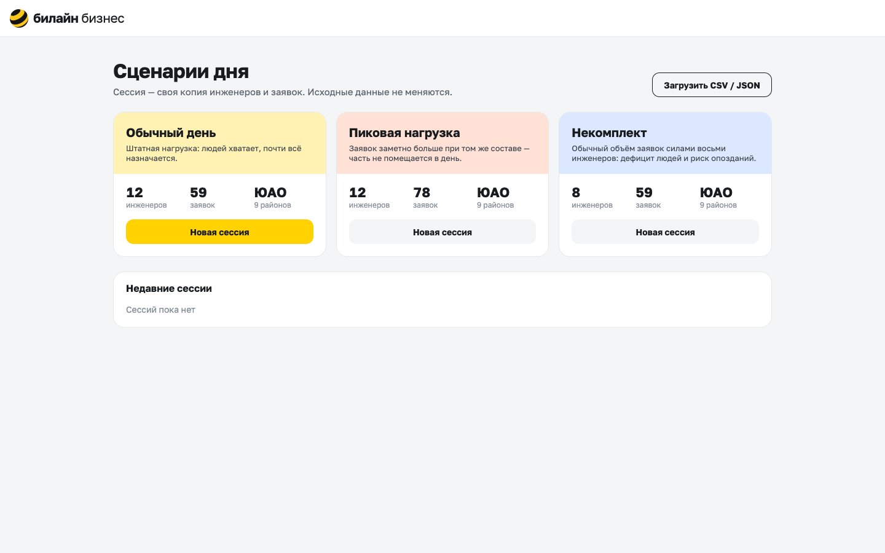

Три встроенных сценария и кнопка загрузки своего CSV или JSON. «Новая сессия» копирует сценарий в
рабочую сессию, исходные данные при этом не меняются. Недавние сессии остаются в списке: к любой можно
вернуться после перезапуска сервера.

## 2. Запустить планирование

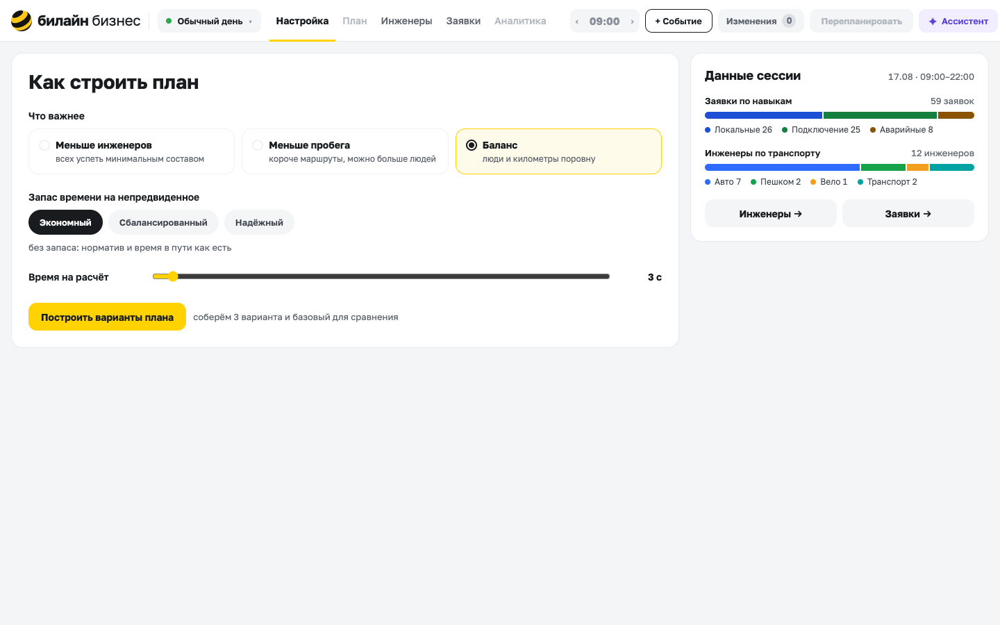

Настроек три, и все сформулированы словами диспетчера, а не параметрами солвера:

- что важнее: меньше инженеров, меньше пробега или баланс;
- сколько заложить запаса на непредвиденное;
- сколько секунд считать.

Справа сводка по сессии: сколько заявок каждого навыка и инженеров на каждом виде транспорта.

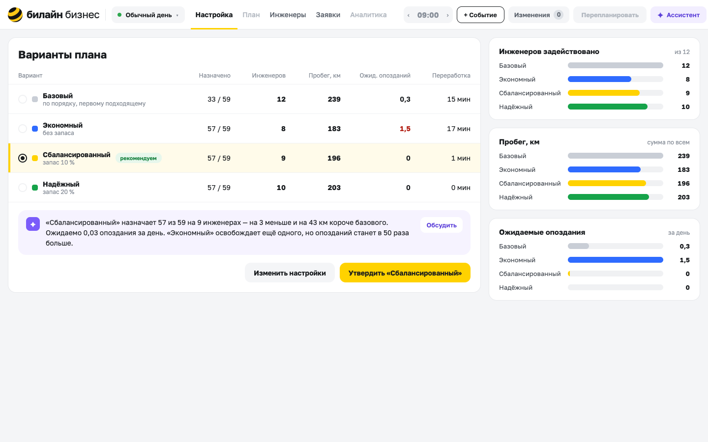

«Построить варианты плана» считает четыре плана: базовый (по порядку, первому подходящему) и по одному
на каждый запас. В таблице для каждого указано:

- сколько заявок назначено;
- сколько инженеров задействовано;
- пробег;
- ожидаемые опоздания по стресс-тесту;
- переработка.

Один вариант помечен «рекомендуем», и под таблицей сказано почему. Здесь «Сбалансированный»
назначает 57 из 59 на девяти инженерах. Это на три человека меньше и на 43 км короче базового. Экономный
освобождает ещё одного, но опозданий у него ожидается в 50 раз больше. Выбирает диспетчер: утвердить
можно любой.

## 3. Распределение и маршруты на карте

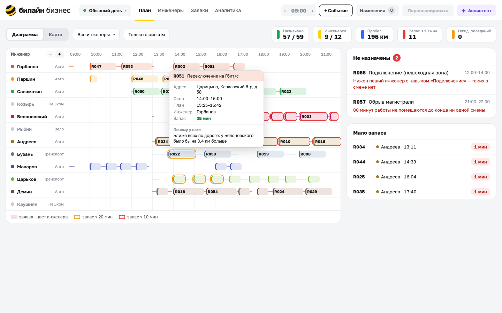

Утверждённый план открывается диаграммой: строка на инженера, блок на заявку, цвет блока - цвет
инженера. Рамка показывает запас: оранжевая - меньше 20 минут, красная - меньше 10. Наведение на блок
показывает окно, план и короткое «почему у него».

Сверху плашки с метриками: назначено, инженеров, пробег, сколько остановок с запасом меньше 10 минут и
ожидаемые опоздания. Справа неназначенные заявки, у каждой конкретная причина. Ниже список «Мало
запаса»: где план хрупкий.

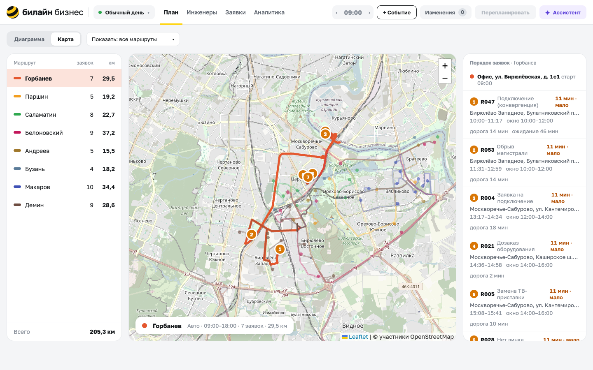

На карте маршруты всех инженеров. Для машин линии идут по улицам: геометрию отдаёт OSRM. Пешие,
велосипедные и маршруты на общественном транспорте нарисованы прямыми пунктиром: время у них
оценочное. Слева список маршрутов с числом заявок и километрами, справа порядок заявок выбранного
инженера с дорогой, ожиданием и запасом у каждой.

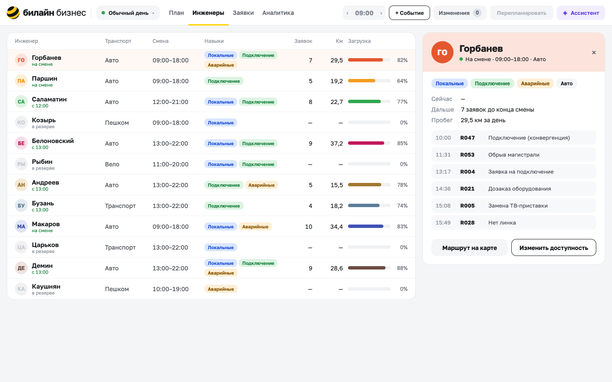

Экран инженеров - то же самое в разрезе людей: кто на смене, кто в резерве, загрузка, пробег, план дня
выбранного.

## 4. Почему заявка назначена этому инженеру

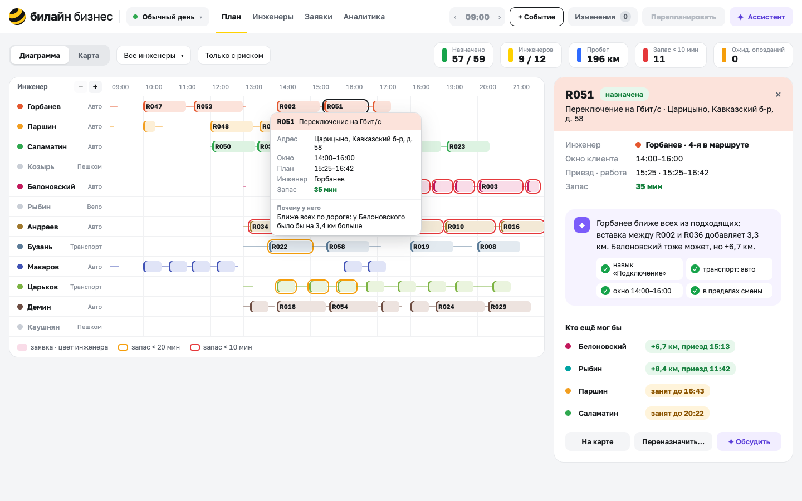

Клик по заявке открывает карточку. Здесь R051, переключение на гигабит в Царицыно, окно 14:00-16:00.
Она у Горбанева, четвёртой в маршруте. Горбанев ближе всех из подходящих: вставка между R002 и R036
добавляет 3,3 км. Белоновский тоже мог бы, но это плюс 6,7 км. Отдельно отмечены четыре проверенных
ограничения: навык, транспорт, окно и смена.

Ниже «Кто ещё мог бы»: цена каждой альтернативы или причина, почему нельзя («занят до 16:43»). Этот
список не придуман моделью: заявку пробно вставляют в маршрут каждого совместимого
инженера.

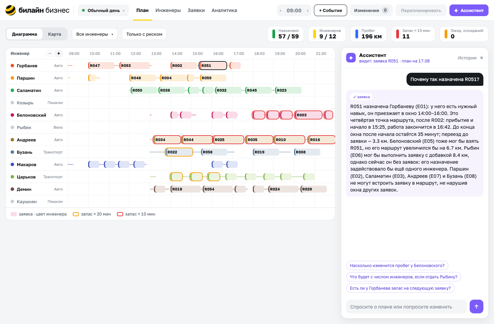

«Обсудить» открывает ассистента с контекстом этой заявки. Ответ собран моделью из фактов, которые
вернули инструменты над планом. Среди них есть неочевидный: Рыбин взял бы заявку за 8,4 км, но он сейчас
без заявок, и назначение вывело бы на смену ещё одного человека. Под ответом подсказки следующих
вопросов по контексту. Без ключа к модели ассистент отвечает шаблоном из тех же фактов.

## 5. Событие

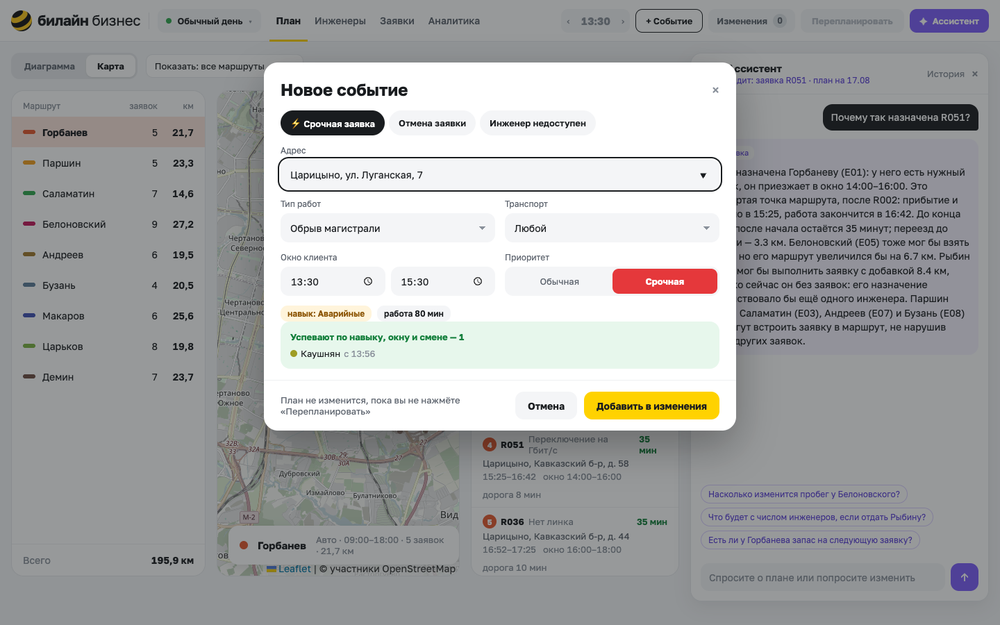

«+ Событие» - срочная заявка, отмена или недоступность инженера. Пока диспетчер заполняет форму срочной
заявки, внизу уже видно, кто успевает по навыку, окну и смене и с какого времени. Кнопка называется
«Добавить в изменения», и под ней прямо написано: план не изменится, пока вы не нажмёте
«Перепланировать».

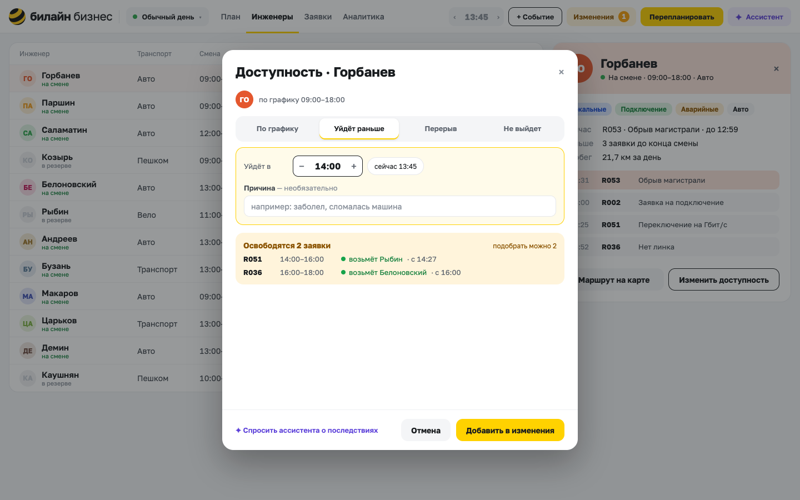

Недоступность инженера - это уход раньше, перерыв или «не выйдет». Для ухода в 14:00 окно сразу
показывает, какие заявки освободятся и кто их, скорее всего, возьмёт. Это тот же быстрый пересчёт, что
сделает кнопка, только без записи.

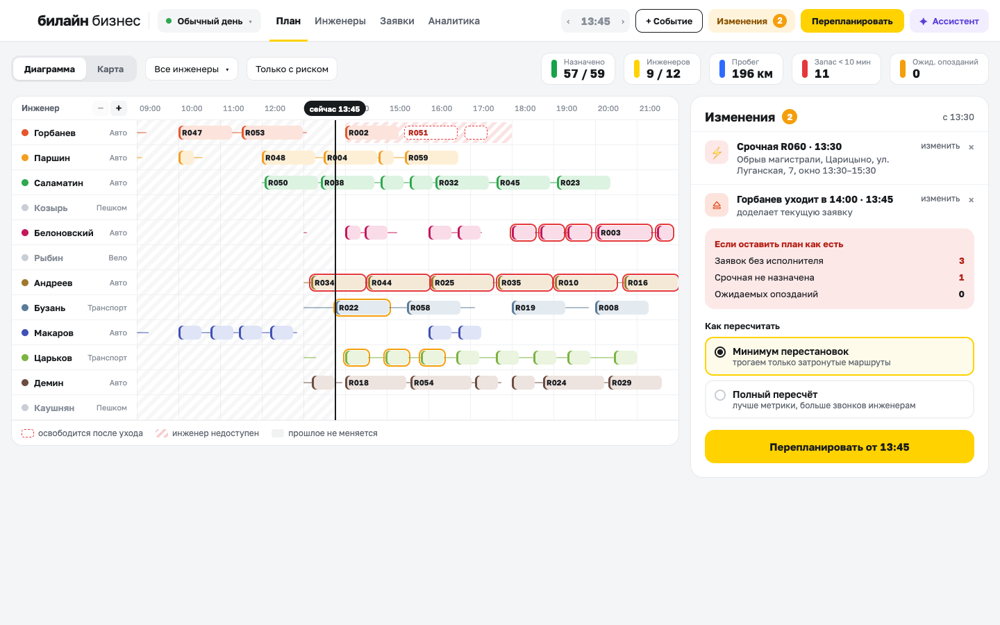

События копятся в очереди «Изменения». На диаграмме видно, что затронуто: заявки ушедшего Горбанева
после 14:00 обведены пунктиром, его время заштриховано, прошлое слева от линии «сейчас» не меняется.
Справа оценка «если оставить план как есть»: три заявки без исполнителя, одна непристроенная срочная.
И выбор, как пересчитывать: минимум перестановок или полный пересчёт.

## 6. Перестроить план и показать, что изменилось

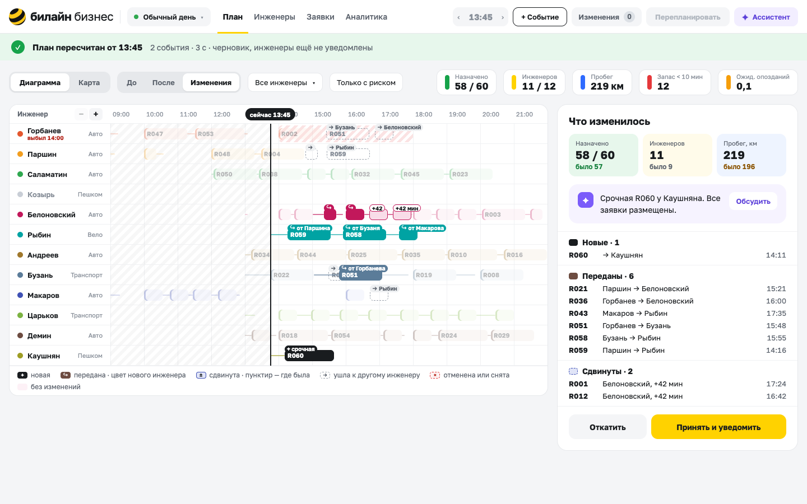

После «Перепланировать» приходит черновик. Плашка сверху: пересчитано от 13:45, два события, три
секунды, инженеры ещё не уведомлены.

На диаграмме режим «Изменения»:

- новая заявка чёрная;
- переданная окрашена в цвет нового инженера, с подписью «от Паршина»;
- сдвинутая подписана «+42 мин»;
- там, где заявка была раньше, остался пунктир.

Справа итог: назначено 58 из 60, срочная R060 у Каушняна, ни одна заявка не потеряна. Ниже поимённо, что
передано, что сдвинуто и насколько. Переключатели «До» и «После» показывают старый и новый план целиком.

«Принять и уведомить» делает черновик рабочим планом, «Откатить» возвращает прежний план, а события
снова встают в очередь.

## 7. Сравнение с базовым вариантом

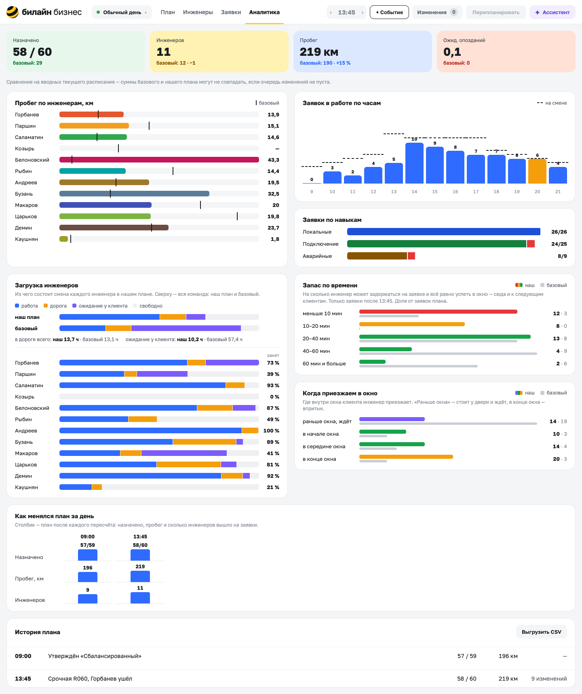

Аналитика сравнивает текущий план с базовым вариантом, посчитанным на тех же вводных. Сверху четыре
главные цифры: назначено, инженеров, пробег, ожидаемые опоздания. Ниже:

- пробег каждого инженера, где черта - сколько у него было бы в базовом;
- загрузка по часам;
- из чего состоит смена каждого: работа, дорога, ожидание у клиента;
- распределение запаса;
- когда инженер приезжает внутри окна.

Внизу видно, как менялся план за день, и есть выгрузка истории в CSV.

Здесь хорошо видно, чем плох последовательный вариант. Время в дороге у него примерно то же, 13,1 часа
против 13,7, а вот ожидания у клиентов 57 часов против 10: инженеры приезжают к закрытым дверям. И
назначает он меньше половины заявок.

## Заявки

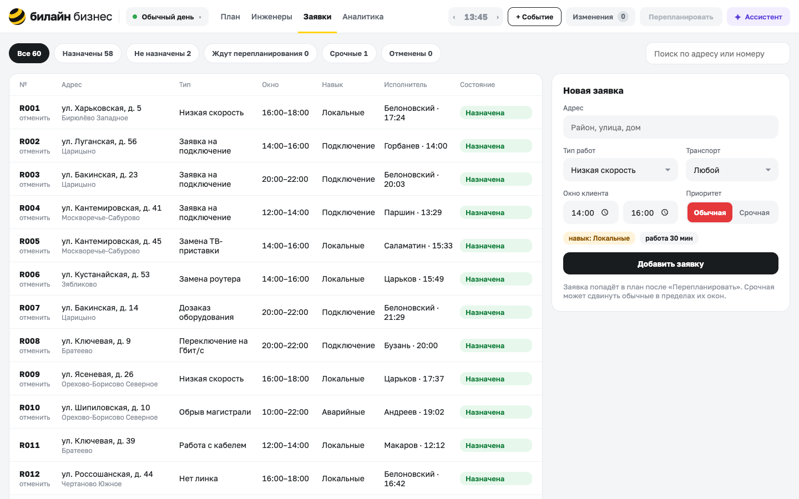

Все заявки сессии с фильтрами по состоянию (назначены, не назначены, ждут перепланирования, срочные,
отменённые) и поиском по адресу или номеру. У каждой есть исполнитель и время начала, а отменить заявку
можно прямо из строки. Справа форма новой заявки: навык и длительность подставляются из типа работ. Как
и любое событие, заявка попадёт в план только после «Перепланировать».
